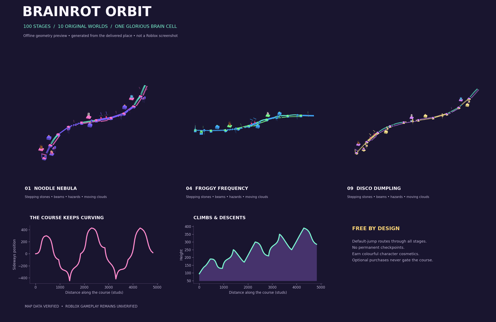

# BRAINROT ORBIT

A colourful, standalone Roblox obby: **100 stages, 10 original meme worlds, one run**. The floating course climbs, drops and bends through noodle planets, toast goblin skylines, frog frequencies, galaxy geese and disco dumplings.

**Open [dist/BrainrotOrbit.rbxl](dist/BrainrotOrbit.rbxl) in Roblox Studio using File → Open from File.** The editable XML version is [dist/BrainrotOrbit.rbxlx](dist/BrainrotOrbit.rbxlx). Both include the map and all scripts; no plugins or package installation are needed to open them. The original `obby_Game.rbxl` is preserved separately.



**Movement correction:** [Platform/stair snagging fixes](docs/FIX_STUCK_CHARACTER.md): non-colliding island collars, client-owned carry, and safe platform restoration. Latest music ID: `134764779929866`.

**Update 3:** [Switchback chaos](docs/UPDATE_3.md): 6,889-stud route, shuffled obstacles, disappearing moving stairs, lifts, crumbling steps, swinging balls, and a labelled NPC rivals board. Brainrot Rap is configured with the supplied audio asset `134764779929866`; actual playback and experience permissions remain unverified.

**Update 2:** [Tung’s Mouth update notes](docs/UPDATE_2.md): smaller corner HUD, dancing brainrot figures, rotating bats, original percussion, and a giant mouth finish.

The automated offline checks pass. **Roblox gameplay, physical devices, actual audio and live purchases have not been verified.** Claude review and Studio playtesting were waived by the requester; that waiver is not a passing test. See [verification results](docs/VERIFICATION.md) and [captured test output](docs/test-output.txt).

## What is included

- Ten worlds with ten stages each, original geometric mascots, floating scenery, neon edging, signs, a colourful lobby and a victory island.
- Fourteen obstacle categories: stepping stones, zigzags, narrow beams, lava, spinners, fading tiles, conveyors, springs, moving clouds, branching lanes, vanishing moving stairs, vertical lifts, pendulum balls and touch-triggered crumble stairs.
- A free default-jump route through every stage, including permanent side routes around timed tiles, lifts, moving clouds and swinging balls.
- Death resets the entire run to the original lobby. There are **no respawn checkpoints**. Best progress, wins, passes and unused stage skips are separate from run progress.
- Robux-only shop: no coin counter, coin rewards or coin cosmetics for sale. Previously saved profiles are preserved.
- Server-owned progression, default Roblox player-list leaderboard, run timer, restart confirmation and optional coil/skip shop.
- Speed Coil and Jump Boot Game Passes; a repeatable ten-credit stage-skip Developer Product; replay-safe receipt processing; server checks on ownership, proximity, order and request frequency.
- Optional promotion cards checked every 50 seconds, alternating coil and skip offers. Cards queue until two safe stationary seconds, disappear on movement, dismiss with X, and never automatically open checkout.
- Saved settings for reminders, music, effects and reduced UI motion. Brainrot Rap uses the supplied Roblox audio ID. Clearing MusicTracks selects the original bundled-sound percussion loop.
- Compact phone layout, scrollable menus, `Activated` buttons for mouse/touch/controller, B or controller Y to open the shop, and controller B to close menus. Device rendering still needs external verification.

## First launch

1. Open **`dist/BrainrotOrbit.rbxl`**, rather than the original prototype.
2. Press **F5** to run. Walk from the lobby towards the first numbered island. Jump with Roblox's normal controls. Tap SHOP or use a lobby kiosk to browse.
3. Unpublished Studio sessions may lack DataStore access. The game falls back to session-only progress and disables paid purchases. It should not require an API key.
4. For persistent progress, publish to an experience you own. To test persistence *inside Studio*, enable **Studio Access to API Services** in that test experience's security settings.

## Optional Robux products

The creator supplied and confirmed these connected items. See [Robux setup and publishing steps](docs/ROBUX_SETUP.md).

| Item | Type | Configured ID |
|---|---|---|
| Speed Coil | Game Pass | `2038121195` |
| Jump Boot | Game Pass | `2041634630` |
| 10 Stage Skips | Developer Product | `3720254856` |

Each confirmed skip purchase moves forward **up to 10 stages at once** from a safe island. If airborne or outside an active run, the purchase is saved: use **SKIP +10** in the shop once safely standing in the course. Near the finish, unused stages remain saved. Duplicate receipts never repeat the teleport or grant. Death still resets run progress.

Everyone joins with normal movement and no paid items equipped. Only verified pass owners can enable the boosts in the shop: Speed Coil increases WalkSpeed from **16 to 32**, and Jump Boot increases JumpPower from **50 to 100**. Both work together. Each shop item has a **BUY • R$** button that requests the official Roblox purchase prompt. Owned passes are labelled in the description and Buy equips them without a second charge; Roblox does not allow repeat Game Pass purchases.

Prices come from Roblox, including regional client pricing; no Robux amount is hard-coded. Both passes must be on sale and the products must belong to the experience you publish over. Purchases require available DataStore persistence. Lobby and numbered safe islands can display optional offers after the 50-second cadence and two stationary seconds. Settings can turn reminders off.

Open the new download in Studio and publish it **over the same existing experience** that owns these products. For Studio persistence tests, enable Studio Access to API Services. Live marketplace ownership, availability, pricing and actual transactions remain unverified here; offline tests use service doubles and never spend Robux.

## Build and verify

Python 3.10+ builds the editable place with the standard library:

```sh
python3 tools/build_place.py
```

For the full offline suite on Linux x86_64, install the checksum-pinned Luau 0.743 and Lune 0.11.0 tools:

```sh
python3 tools/bootstrap_tools.py --destination .test-output/tools
python3 tools/verify.py --tools .test-output/tools
```

This builds the XML, checks all 100 routes, compiles all production Luau, type-checks the shared modules, runs real shared rules and production server/client scripts against service doubles, validates the place using Lune's Roblox reader, and writes the binary place after a successful round trip. It stops on any failure. The tool installer requires GitHub/release asset network access and verifies pinned SHA-256 checksums before extracting executables.

The geometry suite also runs independently without extra tools:

```sh
python3 -m unittest discover -s tests -p 'test_*.py' -v
```

`python3 tools/render_preview.py` optionally regenerates the offline design preview with Matplotlib. It is a geometry illustration, not evidence of Roblox gameplay.

Edit sources under `src/` and the map generator under `tools/`. Rebuilding replaces generated files in `dist/`; do not edit those files and then rebuild without preserving your edits. Save Studio edits as a separate file if you want to keep them. See [architecture and limits](docs/ARCHITECTURE.md) and [external test instructions](docs/EXTERNAL_TESTS.md).
